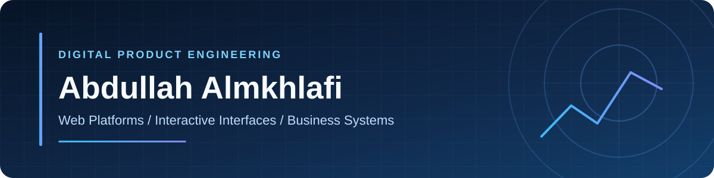

 

### عبدالله المخلافي | Abdullah Almkhlafi

**تطوير منصات رقمية · واجهات تفاعلية · أنظمة أعمال**

أحوّل الأفكار إلى منتجات رقمية عملية، مع التركيز على جودة التجربة، سلامة البيانات، الأمان، وقابلية التشغيل.

 

---

### المشاريع المختارة | Featured Projects

<table>
<tr>
<td width="50%" valign="top">

#### [RAKAN BALANCE](https://github.com/aalmkhlafi77-sudo/rakan-balance)
دفتر حسابات شخصي لإدارة الحسابات والحركات المالية وكشوف الحساب.

`Finance` · `React` · `TypeScript`

</td>
<td width="50%" valign="top">

#### [Professional AI Skills Hub](https://github.com/aalmkhlafi77-sudo/Professional-AI-Skills-Hub)
مكتبة مهارات احترافية مع معايير قبول ومراجعات جودة وأمان.

`AI Skills` · `Security` · `Quality`

</td>
</tr>
<tr>
<td width="50%" valign="top">

#### [Smart Trader Pro](https://github.com/aalmkhlafi77-sudo/smart-trader-Pro)
أدوات لإدارة بيانات التجارة والتسعير وتكاليف الحمولة.

`Business Tools` · `Data` · `Pricing`

</td>
<td width="50%" valign="top">

#### [Luxury Home](https://github.com/aalmkhlafi77-sudo/luxury-home)
منصة لإدارة العقارات والوحدات والحجوزات والإيجارات.

`Real Estate` · `React` · `Backend`

</td>
</tr>
<tr>
<td width="50%" valign="top">

#### [Beso Studio V2](https://github.com/aalmkhlafi77-sudo/Beso-Studio-V2)
استوديو لإنشاء عناصر واجهات المستخدم وتخصيصها ومعاينتها.

`UI Studio` · `Components` · `Design`

</td>
<td width="50%" valign="top">

#### [Abdullah Almkhlafi Portfolio](https://github.com/aalmkhlafi77-sudo/Abdullah-Almkhlafi-Portfolio-Clean)
مشروع الموقع الشخصي وإدارة المحتوى والوسائط.

`Portfolio` · `Node.js` · `MySQL`

</td>
</tr>
</table>

**مشروع خاص:** [Cinematic UI Showcase](https://github.com/aalmkhlafi77-sudo/Cinematic-UI-Showcase) — تجارب واجهات سينمائية تفاعلية؛ رابط المستودع متاح فقط للمصرح لهم.

---

### مجالات الخبرة | Expertise

**واجهات المستخدم والتفاعل**

**الخوادم وقواعد البيانات**

**الجودة والتسليم**

---

**الفكرة الجيدة تستحق تنفيذًا متقنًا.**

[الموقع الشخصي](https://almkhlafi.carpetbazar.org/) · [جميع المستودعات العامة](https://github.com/aalmkhlafi77-sudo?tab=repositories)

تختلف المشاريع في مراحل التطوير. بعض المستودعات خاصة ولا تظهر إلا للمصرح لهم. الرموز التقنية تستخدم خدمة shields.io الخارجية.

